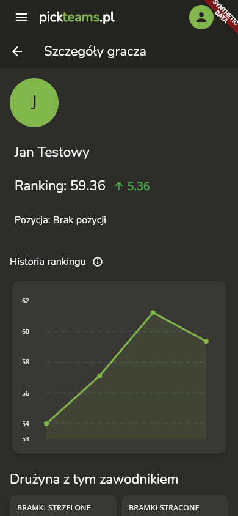
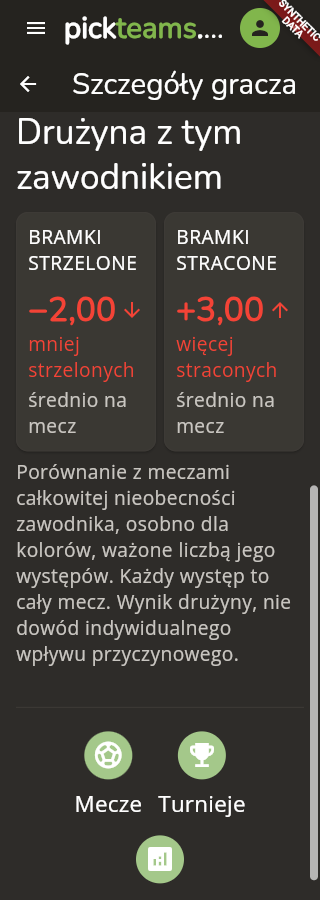
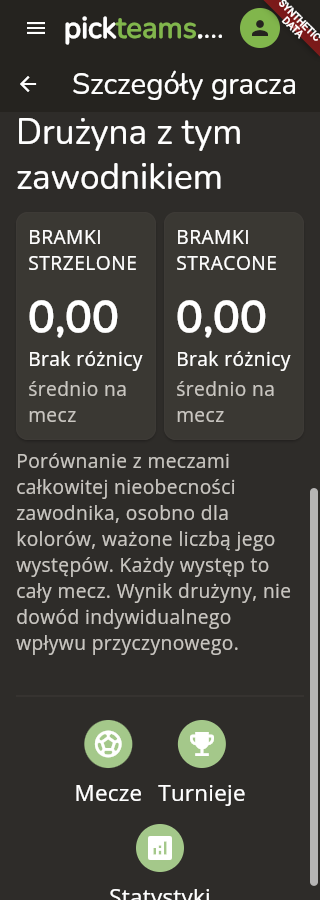
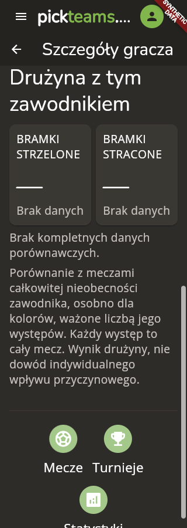
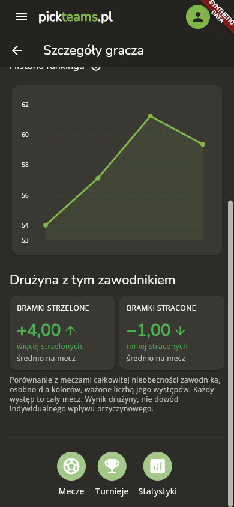

# Player goal comparison: reviewed repair evidence (#59)

The profile compares team goals with the player against total absence, separately
by color and weighted by player appearances. Ordinary tournament matches now count.
Returning from Matches or Tournaments refreshes the comparison after match edits.

## Source and checks

Built and tested source: `c054ded9b8cd3ab8fa22f3dc888d8979e9df3e08`.
Both production and fixture JavaScript builds use that source. Its complete `app/`
tree is `f0d5be3ef70588d58ba431241a4504240a289d8e`. The subsequent publication-evidence
commit changes only `docs/review/issue-59/`; its full SHA is the containing Git
commit, also recorded in the external archive's `final-sha.txt`.

Flutter **3.47.9**, Dart **3.13.7**. Commands ran serially under the shared
`/tmp/pickteams-flutter-validation.lock`, with `MemAvailable >= 2621440 KiB`
before each heavy command. The initial admitted validation used the then-permitted
bounded lock wait. The final capture used immediate `flock -n -E75`. Current
resource policy supersedes the older bounded-wait permission in the proof guide:
new heavy commands must use immediate admission, and stop on contention/low memory.

With `F=/home/agents/.local/share/pickteams-f001-sdk/flutter/bin/flutter`, from `app/`:

| Command | Actual result |
| --- | --- |
| `$F pub get --enforce-lockfile` | Passed; lockfile unchanged. |
| `$F analyze --no-pub` | No issues; exact committed configuration. |
| `$F test --no-pub --concurrency=1 test/features/players test/widgets/players` | 140 passed. |
| `$F test --no-pub --concurrency=1 --coverage` | 491 passed, one existing web-only auth test skipped. |
| `python3 -m unittest discover -s tool -p test_capture_goal_comparison.py -v` | Four passed; includes tournament capture labels. |
| `$F build web --release --no-pub --no-web-resources-cdn --no-wasm-dry-run --output build/issue59-production` | Passed. |
| Same build flags, `--target tool/player_details_preview.dart --output build/issue59-fixture` | Passed. |
| `playwright-local python app/tool/capture_goal_comparison.py http://127.0.0.1:18859 <archive>/frames` (repo root) | 36 section + four profile frames; no page errors or blocked external requests. |

Flutter's pub-get migration adds platform/build exclusions automatically. That
generated diff was recorded, then removed **before** analysis. Configuration SHA256
before/after analysis was identical:
`e0ea485cfdbc3e12b93efb8679a5ea73ebfe20ea4ca0c473dc594fc2fb274ed5`.
No temporary exclusions were used for the reported analysis. No SDK/platform
analysis diagnostic remained on this candidate. Both builds are JavaScript builds;
Wasm compatibility was not tested.

## Discriminating regressions

- Decoder → calculation: the creator's persisted `tournament_home_team_id` and
  `tournament_away_team_id` metadata, red 6–2 with the player and red 2–3 with total
  absence, gives **+4 scored / −1 conceded**. Before the fix the test returned
  `noAppearances`. Mixed ordinary/tournament history gives +3 / 0 while excluding
  penalties, walkover, unknown score types and unknown scoring metadata. Only the
  two known non-scoring metadata keys are allowed; arbitrary metadata stays excluded.
- Profile → real `PlayerMatchesPage` → real `MatchDetailsPage` → controller edit →
  back twice: scores, memberships and colors each have successful/rejected-save
  cases. Without return invalidation, all six failed: successful edits kept old
  values and history reads stayed at one. With the fix, all six pass and history
  is read twice. Use-case persistence is synthetic. The tests call the real
  `MatchDetailsNotifier` actions, **not** the score/team editor controls. Actual
  backend persistence and complete editor-control interaction remain unverified.
  This replaces the weaker Matches destination-only test.

Full logs, coverage, built artifacts, all frames, capture checks and reproduction
logs are archived at
`/home/agents/dev/pickteams/.limen/proof/issue-59/<publication-evidence-commit-sha>/`.
Logs retain their original source-SHA execution paths. `checks.json` contains the
selected frame checks; `SHA256SUMS` binds the unchanged PNGs. Bundles and coverage
are deliberately not committed. The loopback server was stopped after capture.

## Actual screenshots

All six images below were opened after the final capture. They show running
production profile widgets with **synthetic fixture data**, not mockups or
production data. Chromium headless uses CSS viewport sizes, not physical phones
or device/touch validation. The red banner marks synthetic data. Text scale is
Flutter's linear text scale; device scale factor is 1.

Positive mobile context, **390 × 844 CSS px, text 1.0**. The ranking graph is the
existing profile graph, not a new comparison chart.



Positive comparison, **390 × 844, text 1.0**: +3.00 scored/up and −0.50 conceded/down
are green. Both cards precede profile navigation.


Opposite signs, **320 × 900, text 1.6**: −2.00 scored/down and +3.00 conceded/up
are red. Numbers remain on one line; descriptions stay inside their cards.



Rounded zero, **320 × 900, text 1.6**: raw +0.004 / −0.004 both display neutral zero,
without favorable arrows.



Missing played-color baseline, **320 × 900, text 1.6**: no fabricated zero; the
reason is visible below both cards.



Tournament metadata, **390 × 844, text 1.0**: actual decoder/calculation fixture
shows +4.00 scored / −1.00 conceded, not an omitted tournament sample.



Repeat the source/evidence binding from the publication-evidence commit:

```sh
git diff --exit-code c054ded9b8cd3ab8fa22f3dc888d8979e9df3e08 HEAD -- . ':!docs/review/issue-59'
git rev-parse HEAD:app c054ded9b8cd3ab8fa22f3dc888d8979e9df3e08:app
(cd docs/review/issue-59 && sha256sum -c SHA256SUMS)
```

No production data, physical phone, live RLS, merge or deployment was tested or
changed. The repair worker did not push or open a PR. The parent feature coordinator
is authorized to publish after independent re-review; no new owner approval is needed.
